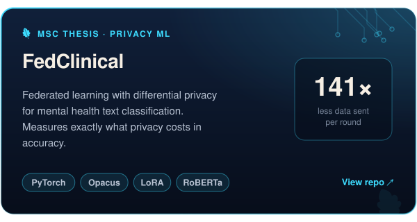
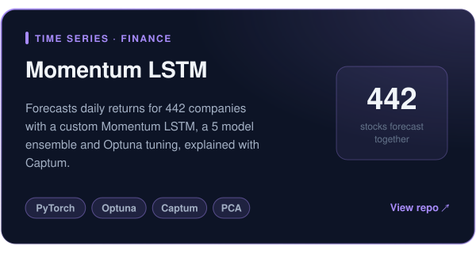
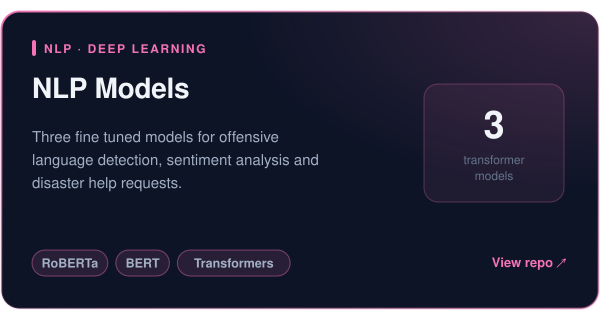
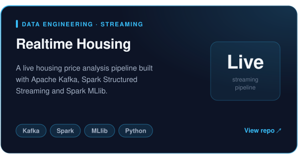
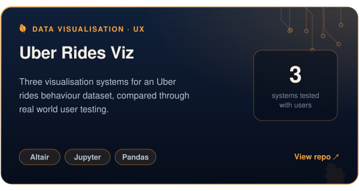
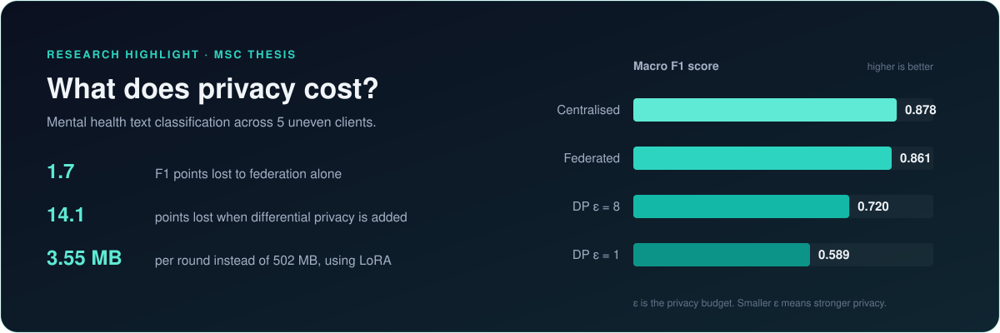
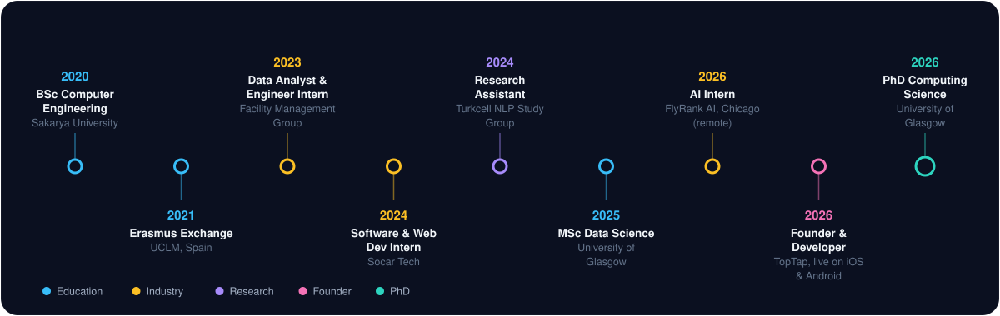
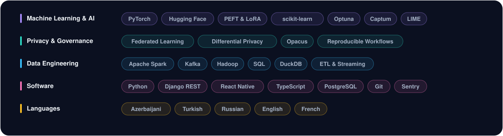

  

  
  
  

<h2 align="center">Featured Projects</h2>

 

 

 

  

<h2 align="center">About Me</h2>

I build complete AI systems, from data pipelines to trained models to live products.
I am a PhD researcher at the **University of Glasgow**, working on federated learning, differential privacy and AI privacy.

* 🔬 **Research:** privacy and governance in federated learning
* 📱 **Building:** TopTap, a social sports app I shipped alone to the App Store and Google Play
* 🏦 **Interested in:** applying AI to banking and finance
* 🌍 **Speak:** Azerbaijani, Turkish, Russian, English and French

<h2 align="center">My Journey</h2>

  

<b>Experience highlights</b> (click to open)

 

**Founder and Developer, TopTap** (2026 to now)
Built the React Native app, the Django and PostgreSQL backend and the release pipeline on my own. One REST API serves iOS, Android, the website and an operator panel.

**AI Intern, FlyRank AI** (2026)
Built an end to end ML pipeline that ranks web pages for content refresh, using real Google Search Console data with strict leakage checks.

**Research Assistant, Turkcell NLP Study Group** (2024 to 2025)
Benchmarked multilingual NLP models for sentiment and offensive language detection on Turkish datasets.

**Software and Web Developer Intern, Socar Tech** (2024)
Delivered 3 internal web apps used by more than 100 people across 3 departments.

**Data Analyst and Engineer Intern, Facility Management Group** (2023)
Built Kafka and Hadoop pipelines that cut reporting time from overnight to same day. Reached 89% forecasting accuracy with Spark.

<h2 align="center">Toolkit</h2>

  

<h2 align="center">Let's Connect</h2>

  I am always happy to talk about federated learning, privacy in AI and AI for finance. 
  <a href="https://www.linkedin.com/in/fuad-g-936354272/">LinkedIn</a> · <a href="mailto:gariblifpro@gmail.com">Email</a>

